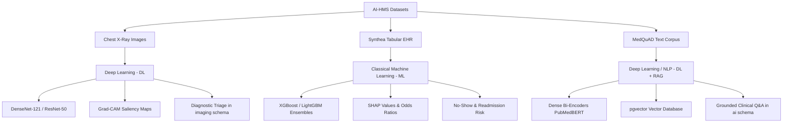

# AI-HMS: Dataset Specifications & Model Strategy (ML vs. DL)

**Project**: AI-Powered Hospital Management System (AI-HMS)  
**Document Version**: 1.0  
**Scope**: Exploration, analysis, and architecture design for MedQuAD, Synthea, and Chest X-Ray datasets  
**Target Systems**: Backend (`FastAPI`), Models Engine (`c:/AI_HMS/models`), Database (`PostgreSQL 18`), Frontend Client (`React + Vite`)

---

## 1. Executive Summary

This document specifies the characteristics, clinical significance, and modeling strategies for the three primary medical datasets integrated into the AI-HMS ecosystem:

1. **MedQuAD (Medical Question Answering Dataset)**: Unstructured clinical text for trusted question answering.
2. **Synthea (Synthetic Patient Electronic Health Records)**: Structured tabular longitudinal health data for risk and operational modeling.
3. **Chest X-Ray (Pediatric Pneumonia Radiographs)**: High-resolution radiographic imagery for diagnostic computer vision.

| Dataset Name | Source / Archive Location | Raw Format & Volume | Clinical Domain | Model Paradigm | Target Architecture |
| :--- | :--- | :--- | :--- | :--- | :--- |
| **Chest X-Ray** | `C:\Users\vaibh\Downloads\x-ray.zip` (2.46 GB) | 17,591 files (~5,856 images), JPEG | Pulmonary Radiography & Infectious Disease | **Deep Learning (DL)** | **DenseNet-121 / ResNet-50** + Grad-CAM Explainability |
| **Synthea** | `C:\Users\vaibh\Downloads\synthea-master.zip` (26.5 MB) | 1,704 files, Tabular CSV / JSON / FHIR | Longitudinal Patient EHR & Operational Flow | **Machine Learning (ML)** | **XGBoost / LightGBM / CatBoost** (Gradient Boosted Trees) |
| **MedQuAD** | `C:\Users\vaibh\Downloads\MedQuAD-master.zip` (16.2 MB) | 11,290 files (47,457 QA pairs), XML | Evidence-Based Clinical Q&A & Drug Information | **Deep Learning / NLP (DL)** | **Sentence Bi-Encoder + pgvector / RAG + Grounded LLM** |

---

## 2. In-Depth Dataset Explanations

### 2.1. MedQuAD (Medical Question Answering Dataset)

* **Source Authority**: Curated by the U.S. **National Library of Medicine (NLM / NIH)**.
* **Volume**: 47,457 verified medical question-and-answer pairs extracted from 12 authoritative National Institutes of Health websites:
  * `Cancer.gov` (National Cancer Institute)
  * `MedlinePlus` (Health & Wellness Topics, Medical Encyclopedia, Prescription Drugs, Herbs & Supplements)
  * `GARD` (Genetic and Rare Diseases Information Center)
  * `NIDDK` (National Institute of Diabetes and Digestive and Kidney Diseases)
  * `NHLBI` (National Heart, Lung, and Blood Institute)
  * `NIAMS`, `NINDS`, and other NIH institutes.
* **Format & Organization**:
  * XML documents organized by originating institute and category.
  * Structured XML tags:
    * `<Focus>`: Clinical subject (e.g., *Type 2 Diabetes*, *Pneumonia*, *Metformin*).
    * `<FocusAnnotations>`: UMLS Concept Unique Identifiers (CUIs) and semantic types.
    * `<QAPairs>`:
      * `<Question qid="..." qtype="...">`: Standardized question text and semantic intent type (`symptoms`, `causes`, `treatments`, `diagnosis`, `prevention`, `complications`, `prognosis`, `susceptibility`).
      * `<Answer>`: Ground-truth clinical guidance authored and vetted by board-certified medical writers and government health panels.
* **Role in AI-HMS**:
  * Powers the Grounded Clinical Decision Support Assistant (`ai.chat_sessions` and `ai.chat_messages`).
  * Forms the grounding corpus for Retrieval-Augmented Generation (RAG) to eliminate hallucinations when clinicians or patients consult the AI.

---

### 2.2. Synthea (Synthetic Mass Bureau of Patient Data)

* **Source Authority**: Open-source clinical simulation engine developed with support from **The MITRE Corporation**, **ONC (Office of the National Coordinator for Health IT)**, and **CMS**.
* **Core Function**: Generates synthetic, realistic, yet completely artificial longitudinal Electronic Health Records (EHR) simulating complete patient lifetimes from birth to death.
* **Data Schemas & Modalities**:
  * Tabular relational tables:
    * `patients.csv`: Demographics, birth date, death date, race, ethnicity, gender, zip code, coordinates.
    * `encounters.csv`: Clinical visits (ambulatory, emergency, inpatient, wellness), admission/discharge timestamps, reason codes.
    * `conditions.csv`: Onset and resolution dates for chronic and acute illnesses mapped to SNOMED-CT and ICD-10.
    * `medications.csv`: Prescription history, dosage, route, duration, RxNorm codes.
    * `procedures.csv`: Surgical and diagnostic procedures mapped to SNOMED / CPT.
    * `observations.csv`: Vital signs (blood pressure, heart rate, BMI, SpO2) and lab test panels (HbA1c, lipid panel, creatinine).
    * `allergies.csv`, `immunizations.csv`, and `claims.csv`.
* **Why Synthetic Data Matters**:
  * Real clinical EHR datasets are subject to strict regulatory barriers (**HIPAA**, **GDPR**, **DISHA**).
  * Synthea models real-world disease progression (e.g., pediatric asthma exacerbations, metabolic syndrome progressing to diabetic nephropathy) without privacy compliance liabilities.
* **Role in AI-HMS**:
  * Provides the statistical baseline already seeded into PostgreSQL (`clinical.patients`, `hospital.appointments`, `clinical.diagnoses`).
  * Serves as the feature store for clinical risk modeling, appointment no-show prediction, and hospital operational flow optimization.

---

### 2.3. Chest X-Ray (Pneumonia Radiographs)

* **Source Authority**: Kermany et al. / Guangzhou Women and Children's Medical Center (Kaggle Benchmark).
* **Volume & Partitioning**:
  * ~5,856 anterior-posterior (AP/PA) pediatric chest radiographs (JPEG format, organized into `train`, `val`, and `test` splits).
* **Classes & Diagnostic Pathology**:
  1. **Normal**: Clear lungs without evidence of focal consolidation, parenchymal infiltrates, or pleural effusion.
  2. **Pneumonia (Infectious Infiltration)**:
     * *Bacterial Pneumonia*: Typically presents with focal lobar consolidation (dense, localized opacification within a discrete lobe).
     * *Viral Pneumonia*: Typically presents with diffuse interstitial "ground-glass" reticular patterns across both lungs.
* **Clinical Significance**:
  * Pneumonia is one of the leading infectious causes of pediatric and adult mortality worldwide. Rapid radiographic triage reduces emergency wait times and accelerates antibiotic or antiviral intervention.
* **Role in AI-HMS**:
  * Directly links to the `imaging` database schema (`imaging.studies`, `imaging.series`, `imaging.instances`).
  * Provides automatic triage priority scoring and visual diagnostic overlays on the clinician dashboard.

---

## 3. Modeling Strategy: Machine Learning (ML) vs. Deep Learning (DL)

Selecting between Classical ML and Deep Learning is dictated by **data modality**, **sample efficiency**, **computational requirements**, and **regulatory interpretability**.



### 3.1. Chest X-Ray: Deep Learning (DL)
* **Paradigm**: Deep Convolutional Neural Network (CNN) / Vision Transformer (ViT).
* **Recommended Architecture**: **DenseNet-121** (Pre-trained on ImageNet / CheXNet) or **ResNet-50**.
* **Why Deep Learning over Classical ML?**
  * Handcrafted visual features (such as SIFT, HOG, or Haralick texture features) cannot capture the non-linear spatial dependencies and subtle contrast gradients characteristic of pulmonary infiltrates.
  * Deep CNNs learn hierarchical visual representations directly from pixel arrays: low-level edges $\rightarrow$ mid-level rib and cardiac contours $\rightarrow$ high-level parenchymal opacities.
  * DenseNet architectures feature dense skip-connections where each layer receives feature maps from all prior layers, maximizing gradient flow and feature reuse—ideal for subtle radiological patterns.
* **Explainability Mandate (Grad-CAM)**:
  * Medical AI cannot operate as a black box. The DL model will incorporate **Gradient-weighted Class Activation Mapping (Grad-CAM)**.
  * Grad-CAM calculates the gradient of the predicted pneumonia score with respect to the final convolutional feature maps, projecting a localized thermal heatmap over the lungs so radiologists can verify that the model is focusing on pathology rather than image artifacts (like markers or borders).

### 3.2. Synthea EHR: Classical Machine Learning (ML)
* **Paradigm**: Supervised Gradient Boosted Decision Trees (GBDT).
* **Recommended Architecture**: **XGBoost (Extreme Gradient Boosting)** / **LightGBM**.
* **Why Classical ML over Deep Learning?**
  * **Empirical Dominance on Tabular Data**: Extensive machine learning research (e.g., Grinsztajn et al., NeurIPS 2022) demonstrates that tree-based ensembles systematically outperform deep tabular architectures (such as TabNet or MLP) on heterogeneous tabular datasets with missing values, skewed distributions, and categorical encodings.
  * **Sample Efficiency**: Tabular EHR cohorts rarely require billions of parameters; tree models train rapidly without GPU memory bottlenecks.
  * **Clinical Interpretability & Regulatory Compliance**: Clinical decision support systems require transparent risk attribution. Tree ensembles allow exact computation of **SHAP (Shapley Additive exPlanations)** values, enabling the HMS to explain *why* an alert was raised (e.g., `+32% risk due to prior 3 no-shows`, `+18% risk due to 25-day scheduling lead time`).
* **Active Deployment in AI-HMS**:
  * Already trained and operational in `c:\AI_HMS\models\no_show` with Platt probability calibration and subgroup demographic fairness verification.
  * Readily extensible to **30-Day Readmission Risk** and **ICU Length of Stay Prediction**.

### 3.3. MedQuAD: Deep Learning / NLP with Retrieval-Augmented Generation (RAG)
* **Paradigm**: Dense Semantic Embeddings + Vector Similarity Search + Local/Hosted LLM.
* **Recommended Architecture**:
  * **Embeddings**: `sentence-transformers/all-MiniLM-L6-v2` or domain-specific `PubMedBERT` / `BioLinkBERT`.
  * **Storage & Indexing**: PostgreSQL `pgvector` extension or embedded FAISS/Chroma index.
  * **Inference Engine**: Grounded LLM (Qwen 2.5 / Gemini) with zero write permissions.
* **Why Deep Learning / Modern NLP over Classical ML?**
  * Lexical keyword search (TF-IDF, BM25) fails when clinical synonymy is involved (e.g., a query asking about "shortness of breath in heart patients" fails to match a document indexing "dyspnea associated with congestive heart failure").
  * Bi-encoder Transformer architectures project queries and documents into a shared continuous semantic vector space.
  * Feeding retrieved MedQuAD chunks into an LLM ensures **clinically grounded, non-hallucinated answers** that cite verified NIH sources.

---

## 4. End-to-End System Architecture in AI-HMS

The three model streams connect cleanly into the existing multi-schema PostgreSQL 18 database and FastAPI service layer:

```
+-----------------------------------------------------------------------------------------+
|                                    AI-HMS PLATFORM                                      |
+-----------------------------------------------------------------------------------------+
|                                                                                         |
|   1. DIAGNOSTIC IMAGING PIPELINE (Deep Learning - CNN)                                  |
|      [x-ray.zip] ---> [DenseNet-121 Classifier] ---> [Prediction + Grad-CAM Heatmap]    |
|                                                     |                                   |
|                                                     v                                   |
|                                   PostgreSQL: imaging.studies, imaging.instances        |
|                                   FastAPI:    /api/v1/imaging/triage-xray               |
|                                                                                         |
|   2. OPERATIONAL & CLINICAL RISK PIPELINE (Classical ML - XGBoost)                      |
|      [Synthea Cohort] ---> [Engineered Features] ---> [Calibrated XGBoost Predictor]    |
|                                                     |                                   |
|                                                     v                                   |
|                                   PostgreSQL: ai.ai_predictions, hospital.appointments  |
|                                   FastAPI:    /api/v1/ml/no-show/predict                |
|                                                                                         |
|   3. CLINICAL KNOWLEDGE GROUNDING PIPELINE (Deep Learning / NLP - RAG)                  |
|      [MedQuAD XMLs] ---> [BioBERT Embeddings] ---> [Vector Index (pgvector / Chroma)]   |
|                                                     |                                   |
|                                                     v                                   |
|                                   PostgreSQL: ai.clinical_knowledge_base                |
|                                   FastAPI:    /api/v1/ai/grounded-query                 |
+-----------------------------------------------------------------------------------------+
```

---

## 5. Implementation Roadmap & Execution Phases

### Phase 1: Tabular Machine Learning (Completed & Operational)
* [x] **Synthea Appointment Cohort Feature Engineering**: Demographic, temporal, and diagnostic feature extraction.
* [x] **Model Comparison**: Logistic Regression vs. Dummy Baseline vs. XGBoost Trees.
* [x] **Calibration & Fairness**: Platt Sigmoid calibration and 5-subgroup demographic parity audit.
* [x] **Deployment**: Model artifact serialized to `models/artifacts/no_show_model.joblib` with live endpoints and UI simulator.

### Phase 2: Diagnostic Deep Learning (Chest X-Ray)
* [ ] **Data Ingestion**: Extract `x-ray.zip` into `data/imaging/chest_xray/` with directory-based PyTorch `ImageFolder` loaders.
* [ ] **Data Preprocessing & Augmentation**: Resize to $224 \times 224$, normalize with ImageNet mean/std, apply affine transforms (random horizontal flips, subtle rotations $\pm 10^\circ$).
* [ ] **Model Training**: Transfer learning using **DenseNet-121** or **ResNet-50** with cross-entropy loss, weighted for class imbalance.
* [ ] **Explainability Pipeline**: Implement Grad-CAM heatmap generator to export overlay visuals.
* [ ] **API Endpoint**: `POST /api/v1/imaging/analyze-xray` returning `{ classification: "Pneumonia", confidence: 0.94, heatmap_url: "..." }`.

### Phase 3: Clinical NLP & Knowledge Retrieval (MedQuAD)
* [ ] **Parser Development**: Python script to parse XML trees in `MedQuAD-master.zip`, extracting `<Focus>`, `<Question>`, `<Answer>`, and `<QType>`.
* [ ] **Vector Indexing**: Generate 384-dimensional embeddings using `sentence-transformers` and store in PostgreSQL vector table.
* [ ] **Retrieval Service**: Top-$k$ cosine similarity search tool `search_clinical_knowledge(query)`.
* [ ] **Grounded Chat**: Wire into FastAPI conversational router with anti-hallucination citation prompts.

---

## 6. Summary Comparison Table

| Attribute | Chest X-Ray Model | Synthea No-Show Model | MedQuAD Q&A Engine |
| :--- | :--- | :--- | :--- |
| **Model Category** | Deep Learning (Computer Vision) | Classical Machine Learning | Deep Learning (NLP / RAG) |
| **Primary Algorithm** | DenseNet-121 / ResNet-50 | XGBoost Classifier (Trees) | Bi-Encoder + Vector Retrieval + LLM |
| **Input Data Type** | Grayscale / RGB Images ($224 \times 224$) | Tabular Features (Float, Int, Binary) | Natural Language Query Strings |
| **Output Type** | Diagnostic Probability + Saliency Map | Attendance Probability + Risk Level | Grounded Answer Text + Source Citation |
| **Hardware Requirement**| GPU Preferred (CUDA / Apple MPS / DirectML)| CPU Sufficient (Lightweight) | GPU/CPU for Embeddings + LLM Engine |
| **Interpretability** | Visual Heatmap (Grad-CAM) | SHAP Attributions & Feature Importance | Explicit Document Citation Links |
